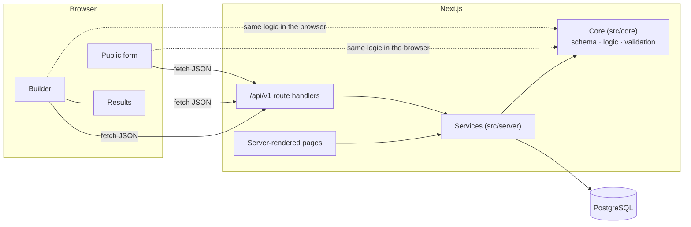

# Survey Builder

A full-stack survey platform. Admins build surveys with conditional logic, publish them as immutable versions and read the results. Respondents answer through a public link, with no account, and can leave and pick up where they left off.

- **Live demo:** _add the deployed URL here_
- **Demo video:** _add the video link here_
- **Demo login:** `demo@example.com`. The password is `DEMO_PASSWORD` in [.env.example](.env.example).

Built with Next.js 16 (App Router), React 19, TypeScript, Tailwind CSS v4, PostgreSQL, Drizzle ORM, Zod and Vitest.

## Contents

- [Features](#features)
- [How it fits together](#how-it-fits-together)
- [Key decisions](#key-decisions)
- [Folder structure](#folder-structure)
- [API](#api)
- [Running locally](#running-locally)
- [Tests](#tests)
- [Deploying](#deploying)
- [Trade-offs and next steps](#trade-offs-and-next-steps)

## Features

Each requirement in the brief, and where it lives:

| Requirement | How it's done |
| --- | --- |
| **Question types**: text, single choice, multiple choice, rating 1–5 | `src/core/survey-schema.ts` defines all four as one Zod discriminated union. The builder, form and analytics each switch on `type`. |
| **Add, remove, reorder, required flag** | The builder's outline and question editor (`src/features/builder`). Reorder by dragging in the outline or with Move up and Move down. A move that would leave a condition pointing at a later question is blocked. Edits autosave after 0.8 s with a visible "Saving… / Saved" status. |
| **Conditional logic** | "Show this question only if…" with `equals`, `not_equals`, `includes`, `not_includes`, `gte` and `lte`. A condition can only point to an earlier question, which rules out cycles. `src/core/logic.ts` evaluates it, and the same function runs in the builder preview, the public form and the server. |
| **Public form, no login, dynamic, validated** | `/s/[surveyId]` renders from the published JSON. Only visible questions are validated. Answers to hidden questions are dropped on the server, so they can't skew results. |
| **Schema stored as JSON, responses separate** | Postgres JSONB: `surveys.draft` and `survey_versions.definition` hold the schema, and `responses.answers` holds the answers, in their own table. |
| **Clean APIs** | A versioned REST API under `/api/v1`. Every response uses one envelope, `{ success, data }` or `{ success, error: { code, message, details } }`. |
| **Analytics** | Total completed and in-progress responses, completion rate, choice counts and percentages, rating average and distribution, and the latest text answers. Computed in SQL, per version. |
| **Bonus: JWT auth** | HS256 JWT in an `HttpOnly`, `SameSite=Lax` cookie. Passwords are hashed with scrypt. |
| **Bonus: versioning** | Publishing snapshots the draft as an immutable version. Each response records the version it answered, and results can be read for each version. |
| **Bonus: partial responses** | The form saves as you go. Reopen the link later and it offers to resume. |
| **Bonus: rate limiting** | Fixed windows stored in Postgres on login, sign-up, starting a response and saving answers. |

Beyond the brief:
- Close and reopen a survey.
- A live preview in the builder.
- A honeypot field against spam bots.
- A same-origin check against CSRF.
- Loading skeletons and error screens.
- Every button shows its pending, done and failed states.

## How it fits together



The code has four layers. Each one only imports from the layers below it.

1. **`src/core`**: pure TypeScript with no framework or database. It holds the survey schema, the conditional-logic engine and the response validator. Because it's pure, it runs in the browser and on the server and is easy to unit-test.
2. **`src/server`**: services that own the business rules and talk to Postgres, such as "publish a survey" or "save a partial response". Each file imports `server-only`, so it can never end up in a client bundle.
3. **`src/app`**: thin route handlers and pages. A handler checks auth, parses input with Zod, calls one service function and wraps the result in the envelope.
4. **`src/features` and `src/components`**: the UI, grouped by feature (builder, form, results, surveys, auth), with a small shared UI kit.

## Key decisions

**JSONB plus immutable versions.**
A survey has an editable `draft`. Publishing copies it into `survey_versions` as version N, and that row never changes again.

Every response stores its `version_id`. So editing a live survey can't break responses already collected, or ones in progress. Someone halfway through v1 can still submit after v2 goes out.

A composite foreign key `(survey_id, version_id)` makes the database itself reject a response that points at another survey's version.

**One schema, enforced everywhere.**
The Zod schema in `src/core/survey-schema.ts` is the single source of truth:
- The builder uses it to show errors.
- The API uses it to reject bad drafts, returning field paths like `questions.2.title` so the UI can highlight the exact field.
- The form and the server use the same validator for answers.

Rules that span fields are checked too: unique IDs, conditions that only point backwards, and condition values that exist.

**Respondents stay anonymous but can resume.**
Starting a response returns a random resume token. The browser keeps it in `localStorage`, the server stores only its SHA-256 hash, and the token travels in the `Authorization` header, never in the URL, so it doesn't end up in logs.

**Analytics in SQL.**
Counts, averages and distributions are aggregated in Postgres with `jsonb` operators. They are never computed by loading every response into Node, so the work scales with the number of questions, not the number of responses.

**Rate limits in Postgres.**
A fixed-window counter is updated with one `INSERT … ON CONFLICT` per request. An in-memory limiter wouldn't work on serverless hosting, where each request can land on a different instance. Postgres also avoids adding Redis for a take-home.

Client IPs are stored as an HMAC, not in plain text. The login limit is checked before the password, so failed guesses count too.

**Security basics.**
- Sessions live in an `HttpOnly` cookie, so page scripts can't read them.
- State-changing requests must come from the same origin (CSRF).
- Login gives the same error for a wrong password and an unknown email.
- An admin only ever sees their own surveys: another admin's survey returns 404, not 403, so its existence isn't revealed.
- Server errors return a generic message and log the details.

## Folder structure

```text
src/
  core/                 Pure domain logic, shared by browser and server
    survey-schema.ts      Zod schema for surveys, questions, conditions and answers
    logic.ts              Which questions are visible for a set of answers
    validate-response.ts  Validates answers (partial or complete) against a version
  server/               Server-only services
    auth/                 Sessions (JWT), password hashing, sign-up and sign-in
    surveys/              CRUD, publishing, close and reopen
    responses/            Start, save, resume and submit; honeypot
    analytics/            SQL aggregation per version
    http/                 Route wrapper: envelope, typed errors, origin check
    db/                   Drizzle schema and client
    rate-limit.ts, env.ts
  app/                  Next.js routes
    api/v1/               REST endpoints (thin)
    (auth)/               Sign-in and sign-up pages
    surveys/              Dashboard, builder (/edit), results (/results)
    s/[surveyId]/         Public form
  features/             UI grouped by feature: builder, form, results, surveys, auth
  components/ui/        Shared UI kit: button, field, dialog, toast, skeleton…
  lib/                  API contract and client shared by browser and server, formatting
test/
  api/                  Integration tests: real route handlers against a real Postgres
  fixtures/
drizzle/                SQL migrations
scripts/seed.ts         Demo data
```

## API

All endpoints live under `/api/v1` and return JSON in one envelope:

```jsonc
{ "success": true, "data": { ... } }
{ "success": false, "error": { "code": "VALIDATION_FAILED", "message": "...", "details": { "fields": { "questions.0.title": "Question text is required" } } } }
```

**Admin endpoints** (session cookie required):

| Method | Path | What it does |
| --- | --- | --- |
| `POST` | `/auth/register` | Create an account and sign in |
| `POST` | `/auth/login` | Sign in (sets the session cookie) |
| `POST` | `/auth/logout` | Sign out |
| `GET` | `/auth/me` | The signed-in admin |
| `GET` | `/surveys` | List my surveys with response counts |
| `POST` | `/surveys` | Create a survey (a draft) |
| `GET` | `/surveys/:id` | A survey with its draft |
| `PUT` | `/surveys/:id` | Save the draft (autosave) |
| `PATCH` | `/surveys/:id` | Close or reopen: `{ "status": "closed" \| "published" }` |
| `DELETE` | `/surveys/:id` | Delete a survey and its responses |
| `POST` | `/surveys/:id/publish` | Publish the draft as the next version. If nothing changed, the current version is reused. |
| `GET` | `/surveys/:id/analytics?version=N` | Results for a version (the latest by default) |

**Public endpoints** (no account):

| Method | Path | What it does |
| --- | --- | --- |
| `GET` | `/public/surveys/:id` | The latest published version, and whether it's accepting responses |
| `POST` | `/public/surveys/:id/responses` | Start a response: `{ versionId, answers, mode: "partial" \| "complete" }`. A partial start returns a resume token. |
| `GET` | `/public/responses/:id` | Resume (`Authorization: Bearer <resume token>`) |
| `PUT` | `/public/responses/:id` | Save more answers, or submit with `mode: "complete"` |

**Error codes:**

| Code | Status | Meaning |
| --- | --- | --- |
| `VALIDATION_FAILED` | 422 | The body or query failed validation. `details.fields` says which fields. |
| `UNAUTHORIZED` | 401 | No valid session, or wrong credentials |
| `FORBIDDEN` | 403 | Cross-origin write blocked |
| `NOT_FOUND` | 404 | Doesn't exist, or isn't yours |
| `EMAIL_TAKEN` | 409 | An account already uses that email |
| `NOT_PUBLISHED` | 409 | You can't close a survey that was never published |
| `SURVEY_CLOSED` | 409 | The survey isn't accepting responses |
| `ALREADY_SUBMITTED` | 409 | That response was already completed |
| `RATE_LIMITED` | 429 | Too many requests. See the `Retry-After` header. |

**Rate limits** (per IP):

| Action | Limit |
| --- | --- |
| Login | 10 per 15 min |
| Sign-up | 5 per hour |
| Start a response | 20 per 10 min |
| Save answers | 300 per 10 min |

## Running locally

Requirements: Node 22+, pnpm and Docker.

```bash
pnpm install
cp .env.example .env      # works as-is for local development
pnpm db:up                # Postgres 17 in Docker on port 5434
pnpm db:migrate
pnpm db:seed              # optional: the demo account with three surveys
pnpm dev
```

Open http://localhost:3000 and sign in as `demo@example.com`, or create your own account.

`pnpm db:seed` is safe to re-run. It resets only the demo account, and its fixed random seed gives the same data every time.

## Tests

```bash
pnpm test             # everything (needs the Docker database for the API tests)
pnpm test:unit        # pure logic only, no database, under a second
pnpm test:coverage
pnpm lint
pnpm typecheck
```

- **Unit tests (63)** cover the schema rules, the logic engine, the response validator, the builder's draft operations and change detection, and formatting.
- **API integration tests (30)** call the real route handlers with real `Request` objects against a real Postgres database (`survey_test`, which is truncated before each test). They cover:
  - auth, sessions and rate limiting
  - versioning, and owner isolation
  - partial responses and resume, and the honeypot
  - closed surveys
  - every analytics number

Coverage: about 97% of statements and 93% of branches.

## Deploying

The app is a standard Next.js app, so any Node host works. The setup this README assumes is **Vercel + Neon** (serverless Postgres):

1. Create a Neon project. Copy the **pooled** connection string.
2. Run the migrations and seed the demo account against it:
   ```bash
   DATABASE_URL="<neon url>" pnpm db:migrate
   DATABASE_URL="<neon url>" DEMO_PASSWORD="<password>" pnpm db:seed
   ```
3. Import the repo into Vercel and set the environment variables:
   - `DATABASE_URL`: the pooled Neon URL
   - `JWT_SECRET`: 32+ random characters (`.env.example` shows how to generate one)
4. Deploy.

## Trade-offs and next steps

Deliberate simplifications, and what would replace them. Those that live in a specific spot in the code are marked there with a `ponytail:` comment.

- **Last write wins** if one survey is edited in two tabs at once. Optimistic locking would fix it: send the loaded `updatedAt` with the save, and only save if it still matches.
- **The survey list isn't paginated.** Add cursor pagination on `(updated_at, id)` once an admin has hundreds of surveys.
- **Stateless JWT sessions.** You can't revoke one session on its own before it expires (7 days). Next step: a sessions table, or a token version per admin.
- **Fixed-window rate limits.** A burst at a window boundary can reach twice the limit. A sliding window, or Redis, would fix that if abuse showed up.
- **Text answers show the latest 50.** Large surveys would need pagination or a CSV export.
- **No email verification or password reset.** Both would need an email provider.
- **Conditions are single rules**, for example "Q1 equals Yes", not AND/OR groups. Groups could be added as a new condition shape, and published versions would stay valid.
- **No end-to-end browser tests.** The API and logic are covered. Playwright tests for builder → publish → respond → results would be next.
